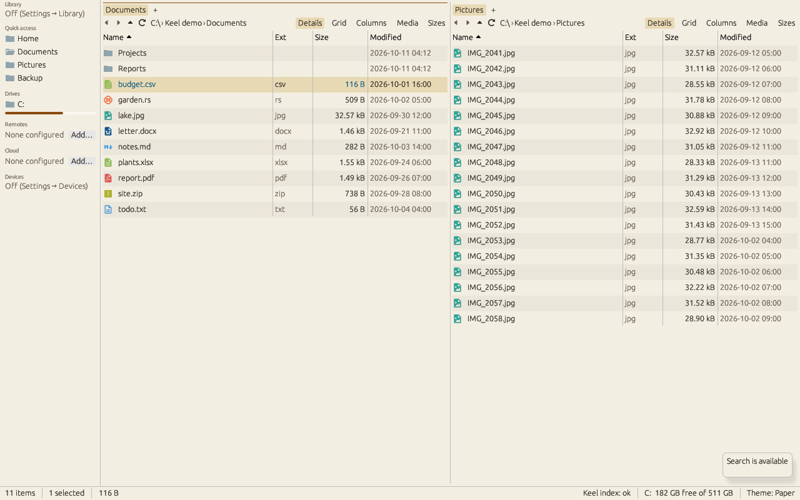

# Files, archives, search and the window

Reference for the file panes and everything around them. The [getting-started guide](getting-started.md) introduces the window and everyday tasks.

## Keyboard shortcuts

| Key | Action |
| --- | --- |
| Space | [Quick Look](#quick-look): a floating preview of the selection (Space or Esc closes it) |
| Ctrl+Space | Select or deselect the cursor row (Space too, with Quick Look on Space turned off) |
| Ctrl+Shift+G | [Go to Folder](#go-to-folder): type a path, with completion |
| Ctrl+Z | Undo the last file operation (rename, move, copy, new item, delete to the trash, a [folder operation](#folder-operations)); see [Undo](getting-started.md#copy-move-and-delete) |
| Ctrl+F2 | Bulk rename the selection (pattern, find/replace, case; Ctrl+Z undoes it) |
| Ctrl+, | Settings |
| Ctrl+Shift+T | Tag picker (library) |
| Ctrl+Shift+A | Tag assign mode: 1–9 toggle tags on the selection, 0 or Esc leaves (library) |
| Ctrl+D | Toggle favorite (library); in a search tab, **Add bookmark** (see [Bookmarks](#bookmarks-filters-and-search-history)) |
| Ctrl+I, Ctrl+Shift+I | Inspector: what the library knows about the selected item (see [Inspector](#inspector)); in a search tab, Match case (see [The search tab](#the-search-tab)) |
| Ctrl+B, Ctrl+U, Ctrl+M, Ctrl+R | In a search tab: Match whole words, Match path, Match diacritics, Regular expression |
| Ctrl+Alt+I | An info window that follows the selection (see [Get Info](#get-info)) |
| Ctrl+Shift+O | Open with… (pick an app for the selected files) |
| Shift+F10 | The Windows menu for the selection (Windows; see [Windows shell menu](#windows-shell-menu)) |
| Ctrl+Shift+Z | Show or hide the drop zone |
| Ctrl+Shift+S | Stash the selection in the drop zone |
| Ctrl+Shift+Alt+K | Global hotkey: bring Keel to the front (configurable) |

These are the defaults. The full list, with your bindings, is in the command palette (Ctrl+Shift+P) and in Settings → Keyboard. Cmd replaces Ctrl on macOS.

### Changing the keys

Settings → **Keyboard** lists every command Keel has: the command palette's, plus the keys the palette does not list (the palette itself, Undo, Backspace, Space, Esc, the cursor keys, Leave the terminal). Type in **Search commands or keys** to narrow the list by name or by key ("ctrl+e" finds what Ctrl+E does).

- **Record** adds a key: press it (Esc cancels the recording). A command can have several keys, or none.
- Click a key (`Ctrl+E ×`) to remove it. **Reset** puts one command's default keys back, **Reset all** every command's. Commands you changed are shown in bold.
- A key another command already has is not taken silently: Keel names that command and offers **Use it for "…"** (the key moves) or **Cancel**. Keys only clash where they work: F6 is Switch pane in the file panes and Leave the terminal in the terminal, and that is not a conflict; ``Ctrl+` `` (the terminal) works in both. A search tab's keys (the five search toggles and Load more, "Search: …") work only in a search tab, where they come first: Ctrl+I is Match case there and the Inspector elsewhere, and that is not a conflict either.
- Some commands must stay reachable: the command palette, Esc (closes the filter, a rename, dialogs and menus) and Leave the terminal always keep at least one key, so removing or moving their last key is refused. Plain Esc belongs to Esc alone.
- Some keys cannot be bound: Ctrl+C, Ctrl+X, Ctrl+V, Ctrl+Insert, Shift+Insert and Shift+Delete (the clipboard's; Copy, Cut and Paste always have them and can get more), Ctrl+= / Ctrl+- / Ctrl+0 (the UI scale), Tab and Shift+Tab (keyboard focus), and a letter, digit or punctuation key without Ctrl or Alt (it types into the filter).
- **Export…** writes every command's keys to a TOML file; **Import…** reads one back (commands it leaves out get their defaults; unknown commands and keys are skipped and named). The file is the same `[keymap]` table that config.toml keeps.

Keys are per profile: config.toml holds only the commands whose keys differ from the defaults, as `[keymap]` with the command's id (shown when you hover its name) and a list of keys, for example `"view.theme" = ["Ctrl+K"]` (an empty list: no key). A hand-edited entry that would break the rules above is skipped at start, with a notice, and the original file kept as `config.toml.bad`. "Ctrl" in the file is Cmd on macOS. Keys inside popups (Ctrl+P's Tab and F5, assign mode's number keys, the media viewer's) and the global hotkeys are set elsewhere.

## Sidebar

The sidebar has four sections, each under a header. Point at a header (or reach it with the keyboard) and it shows **Hide** or **Show**; a click hides or shows the section. Which sections are hidden is kept per [profile](#profiles).

- **Favorites**: your own list. A new profile starts with Recents, Applications (macOS) or Programs (Windows), Desktop, Documents, Downloads and Home (Linux has no Applications folder, so that row is left out there). **Add folders** by dragging them from a pane into the list: a line shows where the folder will go. Dropping on the middle of a folder row copies or moves the items into that folder instead, as a drop on a folder in a pane does. **Add to Sidebar** in the command palette (Ctrl+Shift+P) adds the selected folders, or the current folder when nothing is selected; right-click the Favorites header for **Add current folder** and **Restore default favorites**. **Reorder** by dragging a row up or down, or with **Move up** and **Move down** in its context menu. **Remove** with **Remove from Sidebar** in its context menu. Files cannot be added, only folders. Recents lists the files you opened lately and needs the [library](library.md).
- **Locations**: this computer's drives (a thin bar under each shows how full it is; hover for the free space), the Recycle Bin or Trash, each installed WSL distribution on Windows ([WSL](wsl.md)), the archives you are browsing, your SFTP and FTP hosts with their bookmarks below them, your cloud accounts and your paired [devices](devices.md). Hosts and clouds show their connection status as a dot at the right. Removable drives (USB sticks, SD cards) and optical discs have an **eject** button: on Windows it runs the shell's Eject (as Explorer does) and waits for the drive to go; on macOS `diskutil eject`; on Linux `gio mount --eject`, or `umount` where gio is missing. If the drive is still in use, Keel says so and the drive stays. Mapped network drives show a network icon. While no host or cloud account is set up, **Add server or cloud…** opens Settings → Remotes or Cloud; afterwards these are in the Locations header's context menu.
- **Library**: Overview, ★ Favorites (files you marked with Ctrl+D), each source with its status dot, your saved views, and **Add source…** ([Library](library.md)).
- **Tags**: the library's first eight tags with their color dots, and **All Tags…** for the full list. A click lists everything with that tag. The section is there while the library has tags.

A click opens a row in the active pane and a middle-click in a new tab; the current folder's row has a rounded highlight. The sidebar is one Tab stop: Tab enters it on the Favorites header, the arrow keys move between its rows and headers, Enter or Space opens a row or hides a section, and the context-menu entries are the keyboard path for reordering and removing.

Favorites and hidden sections are saved in the profile's `config.toml`:

```toml
[sidebar]
hidden = ["tags"]

[[sidebar.favorites]]
place = "recents"

[[sidebar.favorites]]
folder = { scheme = "file", authority = "", path = "D:/Work" }
name = "Work"   # optional; the folder's own name when left out
```

`place` is one of `recents`, `applications`, `desktop`, `documents`, `downloads` and `home`, resolved on each computer. An entry Keel does not understand is skipped and the rest of the list loads.

## Columns view and drop zone

Switch a pane to **Columns** from the view buttons in the pane header. Column 0 is the tab's folder; selecting a folder lists it in the next column, and selecting a file shows its preview in the last one. Left/Right move between columns, Enter opens a folder, Up or Backspace step back one column, and the column dividers can be dragged (widths are saved). All file actions work on the column you are in.

The **drop zone** is a strip above the status bar (Ctrl+Shift+Z shows or hides it; it also appears while you drag rows). Drop rows on it, or press Ctrl+Shift+S to stash the selection, then navigate anywhere and use **Paste here** (copy) or **Move here** into the active pane's folder; **Clear** empties it. Items that no longer exist are greyed and skipped, and moved items leave the strip only once they have really moved. The stash is saved with the session. "Reduce motion" in Settings → General turns off the animations.

## Dragging files to other apps

Drag rows out of Keel's window onto another app (a file manager, a mail draft, an editor, a chat window) to hand it the files. The other app copies them; hold its move key while you drop to let it move them instead: Shift on Windows and Linux, Command on macOS. Keel never moves or deletes the files itself. When the drop is over it refreshes the folder, and a move only shows once the other app has really taken the files away (if they are all still there, nothing was moved). Esc cancels the drag. Dropping the files back onto Keel does nothing, and only files on this computer can be dragged out (not files on SFTP hosts, cloud accounts or inside archives).

- **Windows**: a native file drag, as from Explorer.
- **macOS**: a native file drag with each file's icon under the pointer; Finder, Mail, TextEdit and other apps receive the files' URLs.
- **Linux**: works on X11. Keel offers the files as `text/uri-list` over XDND, which GNOME Files, Dolphin, Thunar, browsers, mail apps and most editors take. There is no drag image: the pointer keeps its usual shape while you drag. In a Wayland session dragging out needs Keel to run through XWayland: start it with `WAYLAND_DISPLAY` unset (`env -u WAYLAND_DISPLAY keel`). From a native Wayland window a row drag stays inside Keel (it still drops onto the other pane or a folder), since Wayland only lets the toolkit start a drag. A desktop that takes drops through a proxy window (icons on the desktop) is not a target.

## Quick Look

Space opens Quick Look: a floating window over the file list showing the item under the cursor with the same previews as the preview panel (code and text, Markdown, images, PDF pages, Word, PowerPoint, OpenDocument and spreadsheets, fonts, archives, audio with Play), photos decoded sharp at the window's size, and videos that play with sound after **▶ Play** or a click on the picture (needs `ffmpeg` on `PATH`). The arrow keys move the cursor in the list and Quick Look follows; Space or Esc closes it. Drag its edges to resize it, or use **Full Screen** to fill the screen; **Exit Full Screen**, or closing Quick Look, puts the window back. **Open With…** opens the app picker for the selection.

With several items selected, Quick Look opens on an **index sheet**: a grid of the selected items with their thumbnails. Click one to show it alone; then Left/Right (or Up/Down, Home, End) step through the selected items, wrapping around, without changing the selection, and **Index Sheet** goes back to the grid.

The docked preview panel (F3) stays as it was and can be open at the same time. In the Media view Space still opens the media viewer on photos and videos. To give Space back its old job (select the cursor row), turn off **Space: Opens Quick Look** in Settings → General; Ctrl+Space selects in either case, and **Quick Look** in the command palette always opens it.

## Path bar and status bar

The path bar at the bottom of the window (above the status bar) shows where the active pane is: one crumb per folder from the drive or root down, each with its icon, and the selected item at the end. Double-click a crumb to open it (a file crumb opens the file). Drag files onto a folder crumb to move them there; hold Alt (Option on macOS) while dropping to copy instead. Entries dragged out of an archive are extracted. Right-click a crumb for **Copy as Pathname**, **Open** and **Open in New Tab**. Show or hide it with **Show / hide path bar** in the command palette or **Path bar** in Settings → General.

The status bar's first part reads like Finder's: "12 items, 431.2 GB available" (the free space of the folder's drive, once Keel has read the drives), then the selection and the total size.

## Spring-loaded folders

While you drag files, rest the pointer on a folder (a row, a tile, a column entry or a path bar crumb) for 0.6 seconds and it opens in that pane, so you can drag into a folder a few levels down without letting go; press Space while hovering to open it at once. Moving to another folder starts the wait again. Turn it off with **Dragging: Spring-loaded folders** in Settings → General.

## Go to Folder

Ctrl+Shift+G (or **Go to folder…** in the command palette) asks for a path and opens it in the active pane. Paths are read like the pane's path box: absolute (`C:\Users`, `/usr/local`), `~` for your home folder, relative to the active folder (`..\other`, `sub/dir`), or a location such as `sftp://host/srv`. While you type, the names in the folder you are typing in are listed (folders first; names starting with a dot once you type the dot). Tab completes the only match, or as much as the matches share; Up and Down pick a suggestion and Enter goes there; a file opens its folder with the file selected. Esc closes. The last path typed is kept until Keel closes.

## Inspector

The preview panel has two tabs, **Preview** and **Inspector**. Ctrl+I (or **Show inspector** in the command palette) opens the panel on the Inspector, and hides it when the Inspector is already showing; F3 does the same for the Preview. Like the preview, the Inspector follows the active pane's cursor (or the first selected item). It only reads: nothing in it changes a file.

- **Overview**: name, kind, size, modified date, and the path with a **Copy** button. It comes from the listing, so it shows at once and works for any file, in the library or not.
- **Index journal**: what Keel's own index recorded for the item, newest first (the last 20): created, modified, attributes changed, renamed from (or moved from) its old path, deleted ([Index journal](#index-journal)). It works for any local file, in the library or not, and says so when the journal is off.
- **Library**: the source and the volume it is on (with the volume's state, and *backup* when it is marked as a backup drive), the content id with a **Copy** button, when the index first saw the item, when its bytes were last hashed, and its protection: how many copies the library knows in how many failure domains, and whether it is backed up ([Protection](library.md#protection)).
- **Copies**: every other file with the same content, in any source or on a paired device (a device's own claim says so on hover and is not counted). Click a row to open its folder with the copy selected. A file that is not hashed yet says so: its copies are not known.
- **History**: the operations that touched the item, newest first: copied (to or from), moved (also by a merge, flatten or organize), renamed, deleted, tagged and untagged, each with its time and where it went or came from. It follows the item back through its moves and renames. The first 50 show; **Show all** lists up to 1,000.
- **Tags**: its tags as chips, ★ when it is a favorite, and **Tags…** to open the tag picker (Ctrl+Shift+T).
- **Folder** (for a folder instead of Copies): its size, files, folders and its biggest child, from the library's folder totals ([Folder sizes](#folder-sizes-and-the-sizes-view)).

The library is asked 150 ms after the selection stops moving, on a background thread, so moving through a list stays quick. With the window attached to keel-daemon the same answer comes through the daemon (`library.inspect`, [api.md](api.md)). Outside the library's sources (or with the library off) the Overview still works and the other sections say **Not in the library**. *First seen* and *last hashed* are recorded from Keel 0.21 on: items indexed before show *not recorded* until they are seen or hashed again, and the history starts with what the operation log holds (tagging is logged from 0.21 on).

## Get Info

**Get Info** in a file's, folder's or drive's context menu (or in the command palette, also found as *Properties*) opens an info window for the selection, or for the folder shown when nothing is selected. Several can be open at once, one per item or selection; asking again for the same items brings their window to the front. Ctrl+Alt+I (Option+Cmd+I on macOS) opens one more window that follows the active pane's selection, like Finder's inspector; press it again to close it. Esc closes the window in front. The windows open at the top right of Keel's window and can be moved and resized; each section opens and closes on its header.

- **General**: kind, size (with the exact byte count; a folder's size and *Contains* count its files and subfolders, walked on a background thread), where it is, when it was created and modified, hidden or link, its tags, and **Locked** (the read-only attribute on Windows, no write permission on Unix) for an item on this computer. For a drive: its capacity, available and used space (a drive is never walked). For several items: their count, total size and contents.
- **Tags** (in General): the item's tags as colored dots and names, a row of the seven Finder colors that toggles each color's tag on the items (see [Tags and Finder colors](#tags-and-finder-colors)), and **Tags…** for the tag picker.
- **More Info**: the photo and video metadata the library keeps (dimensions, date taken, camera, lens, location, duration, codec, rating, keywords) and the extension.
- **Name & Extension**: rename the item here (Enter or **Rename**; Ctrl+Z undoes it like any rename). **Hide extension** edits the name without its extension, which is kept; it is a setting of this field, not of the file.
- **Comments**: a comment kept in the library with the item, so it follows the renames and moves the index records. Items outside the library's sources, and all items while the library is off, have the box disabled with a note saying why. Comments stay on this device (library sync does not carry them) and are in [library backups](library.md).
- **Open with**: the applications that open the file (Linux and macOS), **Open**, **Use for all .ext files** (remembered as for Open with…), **Other…** to pick a program, and on Windows **Choose app…** (Windows' own chooser).
- **Preview**: a thumbnail of a picture, else its icon.
- **Sharing & Permissions**: the owner and who may do what. On Windows each account of the access list with its access in Explorer's words (*Full control*, *Modify*, *Read & write*, *Read & execute*, *Read only*, *Special*), deny entries and inherited ones marked; **Windows Security…** opens Explorer's own Properties sheet. On Linux and macOS the owner, the group and everyone else with *Read & Write*, *Read only*, *Write only (Drop Box)* or *No Access*, and the mode (`drwxr-xr-x (755)`). Get Info only shows permissions; change them with **Attributes…** ([Folder operations](#folder-operations)) or the system's tools.

Get Info works for files and folders on this computer, network shares, SFTP hosts, cloud accounts and inside archives; Open with and Sharing & Permissions show for items on this computer only.

## Tags and Finder colors

Library tags take one of Finder's eight colors: red, orange, yellow, green, blue, purple, gray, or none. The tag picker (Ctrl+Shift+T) offers these eight for a new tag; tags made before keep the color they have, and each is drawn in its own color. Tagged items show up to three colored dots after their names in the Details, Icons and Columns views (a tag without a color has no dot; hover the dots for the tags' names).

The context menu of a file or folder ends with a row of the seven colored dots: click one to put the tag of that color on the selected items, or to take it off when they all have it (a ring marks a color every selected item carries). The dot uses the library tag whose color is closest to it, preferring one named after the color, and makes a tag named after the color (*Red*, *Blue*) when there is none. **Tags…** under the row opens the tag picker. Tags need the item to be in a library source; elsewhere a note says to add the drive to the library.

**macOS.** Tags are also Finder's own: Keel reads the Finder tags of files and folders on this Mac (the `com.apple.metadata:_kMDItemUserTags` attribute) when it lists a folder and shows them as dots next to the library's, and when it sets or clears a tag on a local item it writes the change to the item's Finder tags too, so tags set in Keel show in Finder and tags set in Finder show in Keel. The color dots in the context menu work on files outside the library as well (as Finder tags only). A tag set in Finder is not added to the library by itself: tag the item in Keel to have it in the library's search and sync. Other systems have no file tags of this kind; there tags live in the library.

## Windows shell menu

On Windows, right-click files on this computer and pick **More options** at the end of Keel's menu, Shift+right-click them, or press Shift+F10, to get the menu Explorer shows: the handlers your installed apps add (archivers, editors, version control), **Send to**, **Open with**, **Share** and the rest. Shift+right-click and Shift+F10 include the extended commands Explorer shows with Shift held, such as **Copy as path**. Shift+F10 opens the menu at the cursor row.

The same commands are in the command palette (Ctrl+Shift+P) while files on this computer are selected, as **Shell: …** entries named by their place in the menu, for example `Shell: Send to > Documents` or `Shell: Open with > Notepad`. Type `Shell:` to list them: the entries are added the first time you type `shell` in the palette (loading the handlers can take a moment), never when it opens or in the background, and they are dropped when it closes. Commands whose menu item has no text (some apps draw their own) are only in the popup.

Keel takes out the commands it has its own version of, so its rules always apply: Delete (Keel's moves to the Recycle Bin and asks first), Rename, Cut, Copy, Paste, Create shortcut and Properties (Keel's [Get Info](#get-info) window, whose **Windows Security…** button opens Explorer's sheet). The Windows menu works on files and folders in one folder on this computer, network shares included. A name ending in a dot or space is refused: the shell would read it as another file's name (`report.` as `report`), and Keel also checks that the item the shell resolves is the one selected. For files on an SFTP host, a cloud account or a paired device, inside an archive, in the library view, or search results from several folders, **More options** is greyed and says why: a handler would only act on a temporary copy.

The commands come from shell extensions, small programs other apps install into Explorer, and they run inside Keel as they run inside Explorer. A badly written one that crashes closes Keel's window, and one that hangs freezes it until it returns. That is why Keel builds the menu only when you ask for it. If a command misbehaves, the app that added it is the one to update or remove. macOS and Linux have no such menu, so the entry is not shown there.

## Archives

Press Enter or double-click a `.zip`, `.jar`, `.7z`, `.tar`, `.tar.gz`/`.tgz`, `.tar.bz2`, `.tar.xz`, `.tar.zst` or `.rar` file to open it as a folder (an archive inside an archive opens too). Up leaves the archive; preview works on the files inside. Right-click for **Extract here**, **Extract to folder**, **Extract to…**, **Add to "name.zip"** and **Compress to zip…** (pick Zip, 7z, Tar or Tar.gz in the dialog; the last choice is kept as `default_format` under `[archive]` in `config.toml`). Select an existing zip, 7z, tar or tar.gz together with other items from the same folder, or drop files on the archive row, to get **Add to "name"…** (asks first, runs as a cancellable job). Extraction asks before overwriting and refuses entries that would land outside the target folder. It also works into folders on SFTP hosts and cloud accounts: paste or drag entries there, extract an archive that lives there with Extract here or Extract to folder, or open the target folder in the other pane and pick **Extract to the other pane**. Each entry is streamed from the archive to the host and renamed into place once complete.

Inside a `.zip` or `.jar` on this computer you can work as in a folder: Delete, Rename (F2), Cut, Copy and Paste, drag and drop, New folder and New file, and paste or drop files and folders from anywhere (local, SFTP, cloud, another archive) into it. Each operation rewrites the archive once: the new archive is written beside the old one, synced and renamed over it, so a cancel, an error or a crash leaves the original as it was. Entries that stay are copied byte for byte (stored entries stay stored, password-protected entries are never decrypted, zip64 archives stay zip64); new files are deflated. Deleted entries go for good, and their folder stays. Large archives take as long as copying them once.

Everything else is read-only: 7z, tar and RAR archives, an archive inside an archive and an archive on an SFTP host or a cloud account (copy it to this computer first). You can extract from any of them and add files and folders to a zip, 7z, tar or tar.gz with Add to (entries of the same name are replaced; a 7z is re-encoded, a tar is streamed, and the old archive stays untouched until the new one is complete). RAR is read through libunrar and never written. Moving entries out of an archive is not supported: copy them, then delete. Password-protected entries are marked with a lock and cannot be previewed.

## Recycle Bin and Trash

Open **Recycle Bin** (Windows) or **Trash** (macOS; Linux, any freedesktop-compliant desktop) in the sidebar. Columns: Name, Original location, Size, Deleted on. **Restore** moves the selected items back to their original folders; if something with the same name is already there Keel stops and says so instead of overwriting it. **Delete permanently** and **Empty Recycle Bin** remove items for good and ask first (Empty shows the item count). The folder is read-only otherwise: nothing can be pasted, created or renamed in it, and a trashed folder cannot be browsed until it is restored. The preview panel shows trashed files where the system keeps them at a normal path (Windows `$R` files, Linux `files/`, every item on macOS); otherwise it says there is no preview.

**macOS.** The Trash entry lists your Trash folder (`~/.Trash`) and the Trash folder of each mounted volume (`/Volumes/<name>/.Trashes/<your user id>`) as plain folders, so Size and Deleted on (the time the item was moved there) are shown but Original location stays empty: macOS keeps Finder's "Put Back" location where other apps cannot read it reliably. Keel moves files to the Trash itself (through NSFileManager, not by asking Finder), so it needs no Automation permission and makes no sound, but Finder's **Put Back** does not offer itself for the items Keel trashed: use **Restore to…** or drag them out. **Restore to…** asks for a folder and moves the selected items into it; it stops before moving anything when a name is already there or two items share a name, and an item on another volume than the folder you pick is refused (pick a folder on that volume, or copy it out). **Delete permanently** and **Empty Trash** remove the items for good after the same confirmations. macOS lets an app read the Trash only with Full Disk Access: without it the Trash tab says so (System Settings → Privacy & Security → Full Disk Access).

## Recovering deleted files

> **Needs administrator rights, and never recovers onto the same drive.** Reading a drive directly needs an elevated terminal on Windows (Run as administrator) or root elsewhere. Restored files must go to a folder on another drive: writing to the drive you recover from could overwrite the very data you want back, so Keel refuses it.

`keel recover scan <drive or image>` lists the deleted files a drive (`E:`), a device (`/dev/sdb1`) or a volume image (a raw image of one NTFS, exFAT or FAT12/16/32 volume, not of a whole disk) still describes, with an id each:

```
keel recover scan E:
keel recover restore 3 12 --to D:\Recovered
```

`keel recover restore <id>... --to <folder>` writes those files from a scan into an existing folder on another drive, under their names (`name (2).ext` when the name is taken) and with their modified time. It reads the drive again to find them: the saved list only names the files (where they were found, name and size), so a list that was edited can only pick files that are really there. The destination is refused when it is on the drive scanned, on a loop device or virtual disk (VHD, VHDX) whose file is on that drive; the folder is opened once and checked on that handle, and the file created through it, so a junction swapped in afterwards changes nothing. The scan's list is saved for restore in Keel's data folder, else in a folder of yours among the temporary ones, **never on the drive being scanned** (saving there could overwrite the very data you want back); when both are on that drive the list is not saved, and you scan again with `--save <file on another drive>` and restore with `--from <that file>`. Names read from a drive are shown with control characters escaped (`\u{1b}`), so a hostile name cannot drive the terminal. A scan of a folder lists the Recycle Bin items in it instead (`E:\$Recycle.Bin`, or one user's folder in it): original path, size and when it was deleted; a drive's scan lists its Recycle Bin after the deleted files. Restore Recycle Bin items from the [Recycle Bin](#recycle-bin-and-trash). `--json` prints the list as JSON.

What each file system keeps:

- **NTFS**: every MFT record marked free that still has its name and its data (small files live in the record itself, larger ones in clusters its data runs name). The folder path comes from the parent folders' records (`?/` when the parent record was reused). Compressed and encrypted files, and very fragmented ones whose runs continue in other records, are counted under the list but not offered.
- **exFAT**: directory entries with their in-use bit cleared whose name and checksum are still intact, contiguous or following the FAT.
- **FAT12/16/32**: entries marked deleted (`0xE5`) with their long names. A file without a long name lost its first character, shown as `_`. FAT erases the cluster chain on delete, so the data is taken as the clusters right after the first one: a file that was fragmented comes back with other data after its first fragment. Windows also clears the high half of a FAT32 file's first cluster, so a file that started past cluster 65,535 comes back as other data.

The **confidence** column says how much of each file's space is still free: **good** (all of it: very likely intact), **partial** (some clusters were reused since), **overwritten** (all of them were; what comes back is other files' data) or **unknown** (the allocation map does not cover it). The sooner you recover after deleting, the better: everything written to the drive since may reuse the space.

The drive is opened read-only and the parsers never write to it; they are fuzzed against damaged and hostile images ([Fuzzing](fuzzing.md)). What a scan keeps in memory is capped (512 MiB, and a million files): each folder is named once however many files it holds, and a scan that reaches a cap stops with a note under the list. The window has no recovery view yet; it comes with the Disk Usage window.

## Terminal

A terminal pane sits under the file panes. It starts in the active pane's folder and, with "Follow pane" on, changes directory when you navigate. Shells: PowerShell, Windows PowerShell, cmd and each installed WSL distribution on Windows (the same list as the WSL entries in the sidebar's Locations, see [WSL](wsl.md)); `$SHELL`, zsh or bash on macOS; `$SHELL`, bash or sh on Linux.

| Key | Action |
| --- | --- |
| ``Ctrl+` `` (backtick; Cmd on macOS) | Open, focus or hide the terminal. Hiding keeps the shell running; the x button ends it |
| `F6` or `Shift+Esc` | Leave the terminal and return to the file panes |
| `Esc` | Goes to the shell (vim, less, fzf) |
| Context menu, "Open terminal here" | Focus the terminal in the current folder |

"Follow pane" sends a `cd` only when the shell looks idle at a plain prompt; heavily customised prompts (oh-my-posh and similar) can prevent it.

## The search tab

Ctrl+F opens a search tab. Its bar has the backend (System, or Library when the library is on), the query box, Everything's five search toggles and a **Search** menu:

| Toggle | Key | What it does |
| --- | --- | --- |
| Match case (`Aa`) | Ctrl+I | `Report` does not find `report` |
| Match whole words (`ab`) | Ctrl+B | `port` does not find `report.pdf`; `report` still finds `my report.pdf` |
| Match path (`\`) | Ctrl+U | Every term matches the full path (folders and name), not only the name: `old pdf` finds `old\report.pdf` |
| Match diacritics (`é`) | Ctrl+M | Off (the default), letters match their accented forms both ways: `cafe` finds `café` and `café` finds `cafe` |
| Regular expression (`.*`) | Ctrl+R | The whole query is one regular expression over the name (or the path with Match path) |

The keys work in a search tab, also while typing in its query box (elsewhere Ctrl+I is the Inspector); Settings → Keyboard changes them like any other key (see [Changing the keys](#changing-the-keys)). The toggles are per tab and also in the command palette ("Search: Match case", …); a new search tab starts with the ones set under Settings → General → **New searches** (per profile). With Everything as the backend Keel hands the toggles to Everything (Match case, path, whole words and regex as its own search switches, Match diacritics as its `diacritics:` modifier around the query); with Keel's own index and the plain walk Keel applies them itself. `locate` uses only Match case and Regex; Spotlight uses none of them. The library search has its own terms, so the toggles are greyed there.

The query box's hint names what the backend understands: Everything's syntax with Everything, names, `*` and `?` wildcards, `"exact phrase"`, `folder:`, `in:<folder>` and `regex:` with Keel's index (it has no `ext:` or `dm:` yet; those match as plain text), the library's terms with the library.

Results:

- The first 1,000 results show at once ("first 1000 results"). **Load more** (in the bar and the Search menu) asks for four times as many, up to **Most results** in Settings (10,000 by default, at most 1,000,000). The list draws only the rows on screen, so long lists scroll smoothly; Keel's NTFS index looks up the size and date of the extra rows on a worker.
- The parts of each name the query matched are highlighted, and with Match path the parts of the Folder column too. Wildcard terms highlight their fixed parts; `ext:`, `in:` and other `function:` terms are not highlighted.
- The status bar shows the number of results, their total size, and the selection's count and size.
- Ctrl+Enter (also from the query box) or **Open path** opens the result's folder with it selected. **Copy name** copies the file names; **Copy path** copies full paths, in double quotes when Settings → General → **Copy path: In double quotes** is on.

Settings → General → **Search**: **Search as you type** (on; off, Enter runs the query) and its delay (150 ms), and **Match whole filename when using wildcards** (on: `*.pdf` must match the whole name; off: a wildcard term may match anywhere in it, so `*.pd` finds `report.pdf`). With Everything as the backend its own wildcard setting applies.

## Search without Everything

On Windows, when Everything is not running, Keel uses its own index: it reads the NTFS file table and keeps it current from the USN journal, and stores it in the cache folder. Queries are substring, glob (`*.pdf`) or `regex:`, with `folder:` and `in:<path>` filters, and the [search toggles](#the-search-tab).

Reading the whole file table needs administrator rights. Until you grant them Keel indexes your home folder (recursively) plus one level of each drive's root. Settings → General → **Index all drives (administrator)** asks Windows for elevation once and runs a helper (`keel --index-service`) that only reads: it copies each volume's file table records to Keel over a pipe that only your account and administrators can open, and Keel, running as you, builds the full index from them; later starts need no elevation. The status bar names the active backend and shows its state. If Everything is running it is used instead and the button is greyed out.

The helper does as little as it can with administrator rights. It reads the first record of the file table and, on a volume whose table is so fragmented that its list of extents does not fit there, the extra records that hold the rest of that list, to find where the table lies. Before a record leaves the helper it blanks everything the index does not use: the contents of small files and alternate data streams kept inside the record, extended attributes, security descriptors and the unused tail of the record. Names, sizes, dates and attributes go through. Keel then checks everything it receives as untrusted input (only the volumes it asked for, records in order, every record through the same parser that is fuzzed against hostile bytes, names that are a single path component) before it builds and saves the index.

The full index lists every file on the volume, also those in folders your account cannot open (another user's profile, for example), with their sizes and dates. Search results leave those out, as Explorer would ([Folders you cannot open](#folders-you-cannot-open)).

### The index service

Instead of the one-shot helper you can install the **Keel index service** (Settings → General → **Index service** → **Install…**, or `keel --install-service`): a Windows service (`KeelIndex`, LocalSystem, started on demand) that does only the elevated reads (the file table's raw records, the change journal, and the size and dates of changed files) for the one account that installed it, over a private named pipe. Like the one-shot helper it parses nothing a disk holds: Keel, running as you, parses and checks it all. Your normal Keel then builds the full index and keeps it current with no administrator prompt, like the Everything Service. **Uninstall…** (or `keel --uninstall-service`) removes it. What it does, its pipe protocol and its security review are in [The Keel index service](index-service.md).

### Folders you cannot open

The full index holds every name on the drive, including files in other users' folders and system folders. Search results leave out anything inside a folder your account cannot list, as Explorer would: each result's folders are checked with your rights (the answer for each folder is kept for five minutes). This is on by default; Settings → General → **Index privacy** → "Hide files in folders you cannot open" turns it off. When many matches are hidden a search can return fewer results than its limit.

### What the index stores

The helper reads each volume's file table (the MFT) record by record through the volume handle, and keeps for every file and folder: its name and folder, size, size on disk (the clusters in use, so a compressed or sparse file counts what it really takes; a small file kept inside its MFT record counts its size rounded up to 8 bytes, as Windows reports it, and a file compressed with `compact /exe` counts its compressed contents), date created, modified and accessed, attributes, the number of hard links and of alternate data streams, and the reparse tag of links and junctions. A file with several hard links is listed once, by its first name. NTFS's own system files (`$MFT`, `$LogFile`, `$Extend` and what is under it) are left out. A record being written while it is read fails its check and is skipped; the journal replay that follows every build brings the file back. If the volume cannot be read this way (an unusual layout, such as a file table with a hole or one whose extents end before its size), the helper lists it with `FSCTL_ENUM_USN_DATA` instead, which gives names and attributes only; sizes and dates then come in as files change. Keel never takes a partial read of the file table as a complete index.

Every folder also carries totals of everything below it: size, size on disk, files, folders and the newest change. They are counted when the index is built or loaded and kept current from the journal: each change record dates the file (**recently changed**: when Keel last saw it change) and the folders it left or entered, and Keel looks up the new size and dates of each changed file by its file id (up to 20,000 files per two-second poll; past that, the rest keep their old size until they change again). Any column can also keep a ready-made sort order that is updated with each batch of changes, so sorting a large result by size or date does not sort it again. Sorting and filtering search results by these columns comes with the search language.

The index file has a version: an index written by an older Keel is upgraded when it is opened (its new columns stay empty until the next **Index all drives**), and one written by a newer Keel is rebuilt.

On macOS and Linux Keel uses Spotlight (`mdfind`) or `plocate`/`locate` when they answer. Otherwise (and on Windows when nothing else works) it keeps its own **name index** of your home folder: a walk that skips hidden and git-ignored entries, saved in the cache folder (`<cache>/index/walk-<hash>.db`) so the next start is instant, and kept current from file system events in half-second batches. It is rebuilt when it is older than 7 days. The status bar says "indexing N files…" while it builds; searches work as soon as the first build finishes. Queries use the same syntax as above (substring, `*.pdf`, `regex:`, `folder:`, `in:<path>`).

### Folders and volumes (Settings → Search index)

The NTFS index covers fixed NTFS drives. Everything else Keel indexes by walking it: FAT, FAT32, exFAT and ReFS volumes, removable drives, network drives, and any folder you add (a local folder, `\\server\share`, `/mnt/data`). Settings → **Search** has three tabs, like Everything's options:

- **Folders**: the folders to index. Add a path and press **Add folder**.
- **Volumes**: the volumes Keel walks, each with **Include in database** (off keeps it out) and **Include only** (index just these folders of it, `;`-separated, relative to the volume's root). **Automatically include new fixed volumes** (on) and **Automatically include new removable volumes** (off) add a volume when it appears (checked every 10 seconds); a network drive is added by hand (**Add volume**, `Z:\`). **Automatically remove offline volumes** (off) removes an unplugged volume and deletes its index. While it is off, an offline volume stays searchable from its last scan, its name shows "(offline)" here and the status bar says it is offline; it is rescanned when it is back.
- **Exclude**: **Exclude hidden files and folders** (the hidden attribute on Windows, a leading dot elsewhere), **Exclude system files and folders**, **Exclude folders** (a path, a folder name such as `node_modules`, or a wildcard on the name or the whole path such as `*\cache`), **Include only folders**, **Include only files** (wildcards such as `*.pdf; *.docx`; folders are kept) and **Exclude files** (`*.tmp; ~$*`). Lists are separated by `;` and ignore case. The rules apply while indexing, to these folders and volumes (the NTFS index and the home index keep their own rules): what they leave out is never stored, and an index is walked again when they change.

Each folder and volume has its own way of staying current:

- **Monitor changes** (on): watches it for changes (ReadDirectoryChangesW on Windows, FSEvents on macOS, inotify on Linux) and applies them in half-second batches. **Change buffer** (64 KiB, Windows; a network share takes at most 64 KiB) is how many changes Windows holds between two reads; when more arrive the buffer overflows and changes are lost. **Rescan when the change buffer overflows** (on) then rescans; off, the status bar says changes were missed until the next rescan.
- **Rescan**: **Never**, **Every N hours** (after the last scan), or **Daily at** a local time (`HH:MM`). A rescan that fell due while Keel was closed runs at the next start.
- **Fast rescan** (off): a rescan lists only the folders whose modified time changed since they were last listed (a file added, removed or renamed in a folder changes its time), and walks new folders whole. It is much quicker on a large volume, but a file changed in place (same folder time) keeps its old size and date until a full walk. With it on, each start also runs a fast rescan to catch up with what changed while Keel was closed.

A fourth tab, **Journal**, turns the [index journal](#index-journal) on or off and sets its size.

Every entry stores its size, modified and created times and attributes. Press **Apply** to use your edits (**Revert** drops them); settings are saved in the profile's `config.toml` under `[search_index]`. The folder and volume indexes are searched together with the NTFS index (one list, each file once); while Everything runs, its own folder and volume lists apply instead. On macOS and Linux they are searched together with Spotlight, `locate` or the home index; the volumes listed there are the mounts under `/media` and `/run/media` and network mounts (Linux), and the volumes in `/Volumes` (macOS). Their indexes are kept in `<cache>/index/folders/`.

### Index journal

Keel's own index keeps a journal of every change it applies, like Everything's Index Journal: a file or folder **created**, **deleted**, **renamed** (or moved within the index), **modified** (its size or modified time) and with **changed attributes**, each with the time the index applied it and, for a rename, the old and the new path. The folder and volume indexes and the home index write it from their change batches, their fast rescans and what a full rescan found different from the index it replaces; the first walk of an index, and a walk after its Exclude rules changed, are not journaled (that is the index changing, not the files). A folder's own modified time moving because something inside it changed is not listed as a change of the folder.

Renames are paired from the watcher's own rename notice (ReadDirectoryChangesW and inotify report both names). Where it reports none (FSEvents, a rescan), an entry deleted and one created in the same batch with the same size, modified and created times are taken as one file renamed; a file system without created times shows a delete and a create instead. A renamed folder is one entry, not one per file inside it.

The journal is a SQLite file next to the indexes (`<cache>/index/journal.db`). Settings → Search index → **Journal**: **Keep an index journal** (on) and **Size** (64 MB); when the file reaches its size the oldest entries are dropped first. It survives restarts.

**Index journal** in the command palette opens it in a **Journal** tab, newest first (up to 5,000 entries): tick the actions to show, **Changed today**, **From** and **To** (`today`, `yesterday`, `2h`, `30m`, `7d`, `2026-10-12`, `2026-10-12 14:00`; a date in **To** includes that whole day), **Path pattern** (a regular expression on the path or the old path; any case on Windows) and **Search** (part of a path, any case). **Live** (on) reads new entries every 2 seconds; F5 or **Refresh** reads again now. **Export CSV…** saves the entries shown (time, action, path, old path, folder, size). Double-click an entry to open its folder in a new tab with the file selected. The tab is kept with the window's other tabs.

The [Inspector](#inspector) shows a file's newest journal entries, and `keel journal` prints and follows the journal from the command line ([api.md](api.md#keel-journal)). For other code, `keel_search::journal::recently_changed(path)` gives the time a path last changed by the journal (Everything's *date recently changed*, `rc:`), and `Journal::recent(since)` all paths changed since a time at once.

## File lists

A file list is a file that names other files: Everything's **EFU** (`.efu`), or a plain list. Keel opens one as a tab, searches it, writes search results as one, and makes one from a folder.

**Formats Keel reads**, by extension (any other file is read as EFU when its first line names a `Filename` column, else as one path per line):

| Extension | What it holds |
| --- | --- |
| `.efu` | UTF-8 CSV with a header. `Filename` (the full path) is required; `Size` (bytes), `Date Modified`, `Date Created` and `Attributes` (Windows attribute bits, decimal or `0x` hex; 16 marks a folder) are read when present, in any order and letter case; any other column is kept as a property. Dates are FILETIME numbers (100 ns ticks since 1601, what Everything writes) or ISO 8601 (`2024-03-05`, `2024-03-05T14:07:09`, with a fraction, `Z` or `+01:00`; a date without a zone is UTC) |
| `.csv`, `.tsv` | The same columns, comma- or tab-separated. Instead of `Filename` a `Full Path` or `Path` column works, or `Name` with `Path` (the folder: Everything's own CSV export); a file whose first line names none of these has no header, and the first column of each row is the path |
| `.txt` | One path per line; blank lines are skipped, surrounding quotes and spaces dropped |
| `.m3u`, `.m3u8` | One path per line; lines starting with `#` are comments |

Fields follow CSV quoting: a field in double quotes may hold commas and line breaks, and `""` inside it is one quote (Everything quotes every `Filename`). A path ending in `\` or `/` is a folder. A UTF-8 byte order mark is skipped. Reading is bounded: at most 5,000,000 entries and 256 KiB per line (a quoted field's line breaks count towards its line), and a longer file is refused with the line it stopped at. Opening a list never touches the paths it names: sizes and dates come from the list.

**Opening a list as a tab.** "Open file list…" in the command palette (Ctrl+Shift+P), `keel --filelist <file>`, or opening an `.efu` file in a pane (Enter or a double-click) reads the list on a worker and opens a search tab over it, titled with the list's name. It shows every entry at first (up to 100,000 rows); the query box then searches the list's names with the same syntax as Keel's own index: words (every word must be in the name), `*` and `?` wildcards, `regex:`, `folder:` (folders only) and `in:<path>` (under that folder). Exact names come first, then names starting with the text, then the rest. The bar shows how many of the list's entries are shown. Opening, copying or previewing a row works on the file at that path, if it exists on this computer. The tab is not saved with the session: like any search tab it comes back as the folder it started from (the list's folder).

**Exporting.** Right-click in any tab (a search, a file list, or a folder) and choose **Export results…** (**Export list…** in a folder), or "Export results…" in the palette. The dialog picks the format, whether the first line carries the column names (CSV, TSV) or `#EXTM3U` (M3U), whether the file starts with a UTF-8 byte order mark (some Windows programs need one to read UTF-8), and, when rows are selected, whether to write only those. The rows are written in the order shown, through a temporary `.part` file that is renamed when complete.

| Format | What is written |
| --- | --- |
| EFU | `Filename,Size,Date Modified,Date Created,Attributes` and any property columns, `Filename` always quoted, dates as FILETIME numbers, CRLF line ends: Everything opens it |
| CSV | The same columns with dates as ISO 8601 UTC (`2024-03-05T14:07:09Z`) |
| TSV | As CSV, tab-separated; a field holding a tab, a quote or a line break is quoted |
| TXT | One full path per line |
| M3U, M3U8 | One full path per line, `#EXTM3U` first with the header on; both are written as UTF-8 |
| JSON | An array of objects: `filename`, `size`, `date_modified`, `date_created` (ISO 8601), `attributes` and the property columns; missing values are left out |

A folder's or a search's rows carry the size and modified date Keel shows, and attributes for folders and hidden files; created dates are not known there. A path holding a line break is left out of TXT and M3U.

**From the command line** (no window, no library):

```
keel filelist create <folder> -o <file> [--include-files W] [--exclude-files W]
                     [--include-folders W] [--exclude-folders W]
                     [--no-subfolders] [--no-folders] [--no-files]
                     [--format F] [--no-header] [--bom] [--json]
keel filelist export <list> -o <file> [--query Q] [--format F] [--no-header] [--bom] [--json]
```

`create` walks the folder in name order (a folder's entries right after it) with each entry's size, modified and created dates and attributes. Links are listed (as what they point at) but never walked into; folders it cannot read are skipped. Wildcards are separated by `;` or `,` (`*.mp3;*.flac`) and match names without regard to case; one holding `/` or `\` matches the path below the folder instead (`music/live`). `--exclude-folders` leaves out a folder with everything in it; `--include-folders` lists only what is in (or is) a matching folder, still walking the others to find them. `export` writes a file list (any format above) in another format, with `--query` keeping only the entries a search finds (the tab's syntax), in list order. The format comes from `--format` (`efu`, `csv`, `tsv`, `txt`, `m3u`, `m3u8`, `json`), else the output's extension, else EFU; `-o -` writes to standard output. Both print the number of entries written (`--json`: `{"file", "format", "entries"}`); exit codes are 0, 1 (failed) and 2 (usage).

Not yet: a File List Editor (adding files by dragging, merging lists, removing duplicates, rescanning), file lists in the index, the `filelist:` search functions, `.metadata.efu` sidecars and the EFU file association.

## Bookmarks, filters and search history

**Filters.** The combo at the right of a search tab's box narrows the search without changing what you type: **Everything** (no filter), **Audio**, **Compressed**, **Document**, **Executable**, **Folder**, **Picture** and **Video**, then your own. With the System backend a built-in filter is a list of extensions (the library's Kind lists; Executable is programs and scripts such as `exe`, `msi`, `bat`, `ps1`, `sh`, `app`, `AppImage`): Everything gets it as `ext:` (Folder as `folder:`), Keel's own index as a `regex:` term on the name, and every backend's results are checked against it, so Spotlight, `locate` and the other backends show only matching files too. With the Library backend a built-in filter is the matching Kind chip's term (`kind:audio`, `kind:archive`, …; Executable is an `ext:` list). A filter with an empty box searches too: Audio alone lists audio files. **Edit filters…** (at the bottom of the combo, or Settings → Search) makes your own: a name, a search put in front of what you type (`ext:psd;ai dm:thisyear`) and Match case / Regular expression, which are turned on while the filter is picked. They are kept in the profile (`[[filters]]` in `config.toml`). Remote (SFTP, cloud) search tabs take a custom filter's search but not the built-in extension lists.

**Bookmarks.** Ctrl+D in a search tab (or **☆ → Add bookmark…** next to the filter combo) saves the search: its text, backend (System or Library), filter, Match case and Regular expression, sort and view (Details or Grid), under a name, in an optional folder (`Work/Reports`), with an optional **shortcut key** (press **Record…**, then the keys; it needs Ctrl or Alt, or a function key, and may not be one of Keel's own shortcuts or another bookmark's). Bookmarks are listed in the **☆** menu (folders as submenus) and in the sidebar's **Bookmarks** section; a click, or the shortcut from anywhere in the window, runs the bookmark in the active search tab, or in a new one. Right-click a bookmark in the sidebar to edit or delete it (deleting asks first), and **☆ → Organize bookmarks…** (also in Settings → Search) lists them all by folder with ↑ / ↓ to order a folder, **Edit…** and **Delete…**; a bookmark's folder is set in its Edit dialog.

Where they are kept: a bookmark of a **Library** search is one of the library's saved views (in `library.db`, in a backup, and in the API as `views.list`, `views.create`, `views.update`, `views.delete`). A bookmark of a **System** search is kept in the profile (`[[bookmarks]]` in `config.toml`), so it works without a library; **Keep in: Library** saves it in the library's saved views instead. The view also stores columns and a secondary sort for when the search tab has more columns; until then a bookmark sorts by its first key Keel can sort by. Match whole words, Match path, diacritics, prefix, suffix and the ignore-punctuation and white-space toggles are stored too, for the search toggles to come.

**Search history.** A search you run with Enter, pick from the suggestions or leave for its results (clicking a result) goes into the profile's history, `search_history.json` next to its `config.toml`; nothing of it leaves the machine. While you type in a search box, a dropdown under it suggests earlier searches that contain what you typed: Up/Down move in it, Enter or a click runs one, Esc closes it. Settings → Search: **Do not save search history** (nothing is recorded, and what was kept is deleted at once), **Keep at most** N searches (default 200; the least recently used go first), **Always show suggestions** (off: Alt+Down shows them), the order (**Most recent first** or **Most used first**) and **Clear history**.

## Quick Search window, tray and window options

The **Quick Search window** is a small window with only a search field and the results, like Everything's main window. Open it from the command palette ("Quick Search window") or with the optional **Quick Search hotkey** in Settings → General (empty by default; same rules as the global hotkey). Type to search the system index; Enter opens a file in its default app, a folder in a new tab of the main window, and Open location shows the result in the main window. Esc or the close button hides it and keeps the query for next time. The window belongs to the running Keel and its profile.

Settings → General also has:

- **Open searches in new windows**: Ctrl+F (Search files) opens the search in a new Keel window (`keel --new-window --search ""` in the current folder and profile) instead of a tab. Searches handed over from the command line stay in the window that got them.
- **Always on top**: keeps the main window and the Quick Search window above other windows; also "Always on top (toggle)" in the command palette and the Quick Search field's right-click menu.
- **Run in background when closed** (Windows): Keel puts an icon in the notification area; closing the window hides it instead of exiting. A single click on the icon shows Keel; its right-click menu has **Show Keel**, **New window** and **Exit**. No extra dependency is used: the icon is the Windows notification icon API. On macOS and Linux this setting is not shown and closing exits as before.

## Result omissions

Omissions hide exact results from searches without touching the files or the index (Everything's result omissions). In a search tab or the Quick Search window, right-click results and choose **Omit results** (kept in the profile's settings) or **Omit results temporarily** (until Keel exits). **Manage omissions** (right-click menu, command palette, Settings → General) lists both kinds with **Restore** per path and **Clear**; **Show omitted results** turns them all back on without forgetting them; **Omission mode** makes Delete in a search tab omit the selected results temporarily instead of deleting the files. Omissions are applied in the search worker, so they also apply to remote searches, and they match exact paths only (omitting a folder does not hide what is inside it). Saved omissions are stored in `config.toml` under `[omissions]`, per profile.

## Finding folders and files (Ctrl+P)

Ctrl+P opens the finder. Type a few letters of a folder's or a file's name (in order, not necessarily next to each other; the whole path counts) and press Enter: a folder opens, and a file opens its folder with the file selected and the preview shown. Ctrl+Enter opens the result in a new tab, Shift+Enter in the other pane (in a new tab when there is one pane). Each result shows its icon, its name and, dimmed, the folder it is in. Tab switches between **Folders**, **Files** and **Both** (the default); the choice is kept per profile.

The names come from three lists, each bounded:

- **Folders**: every folder the search index knows (Everything, Keel's own index, Spotlight or `locate`), else a walk of your home folder (its first 50,000 folders).
- **Files here**: a walk of the active pane's folder and everything below it, skipping hidden and git-ignored files, up to the first 50,000 files (the popup then says "first 50,000 files here"). Only folders on this computer are walked; in an SFTP, cloud, device or archive folder this list is empty.
- **Library files**: the indexed files of your library's online sources, each source's newest first, up to 100,000 (the popup then says "first 100,000 library files"). Offline sources are left out. Attached to keel-daemon, the names come through the API (`files.names`).

Each list is read in the background when the popup opens and kept for 10 minutes; F5 in the popup reads them all again. You can type at once: until a list arrives the popup says what it is still indexing, with the count so far, and results fill in as the files come. On equal matches the shorter path comes first, and files of the current folder come before library files.

## Folder sizes and the Sizes view

Folders show their total size in the Details **Size** column, and sorting by size puts folders in order of their totals (folders whose total is not known yet come last). The status bar adds up the selected folders' totals, when known.

- **In a library source** the totals are kept with the index ([Library](library.md#library)): they are there as soon as the source's first walk has finished, and follow every change the watcher or a remote check applies.
- **Elsewhere** (the library off, or a folder in no source), **Calculate sizes** (the folder's context menu, or the command palette) walks the shown folder's subfolders as a job in the jobs panel, which you can cancel. The totals are kept until Keel closes, by path and the folder's own modified time: adding, removing or renaming something directly in a folder drops its total until it is walked again, but a change deeper down (a file that grew two folders below) does not change the folder's own time, so its total can be out of date. Run **Calculate sizes** again to walk afresh. A walk keeps the totals of every folder below the ones it walked, so going down into them is instant. Calculate sizes starts on its own only in folders on a fixed disk of this computer outside the library, and only with Settings → General → **Folder sizes: In local folders** on (off by default, because walking a big tree costs disk time); never on a network share (a `\\server\share` path or a mapped drive), a removable drive, an SFTP host, a cloud account or a device.

The Size column shows `…` while a folder is being walked and stays empty while its total is unknown.

**The Sizes view** (the **Sizes** button next to **Media**, or "Sizes view" in the palette) lists the folder's children biggest first, folders and files together. Each row has a bar with its share of the folder, its file count, and its share of the space used on the drive (the drive's own numbers; empty on hosts and cloud accounts). Enter goes into a folder and Backspace back up, as in Details. Outside the library, opening the Sizes view on a folder on a fixed disk walks it once; on a network share, a removable drive, an SFTP host or a cloud account it shows a **Calculate sizes** button instead, since walking those is slow or costs requests.

### Treemap, sunburst and flame graph

Above the Sizes view, **Table**, **Treemap**, **Sunburst** and **Flame graph** switch between the list and a chart of the shown folder (remembered per pane). The chart uses the totals the view already has: the folder's files and folders, and below each folder every total known there (all of them after a **Calculate sizes** walk; in a library source a few levels are read from the index as you look). What a folder holds besides its known subfolders shows as one tile, "Files in …"; folders whose total is not known yet are left out until it arrives.

- **Treemap**: each file is a rectangle sized by its bytes, inside its folder's rectangle. Files are colored by type: the biggest type (by bytes) gets the first of 13 colors, the next the second, and so on, repeating after 13 (WinDirStat's colors, editable). Folders whose contents are not known, and the "Files in" tiles, are gray.
- **Sunburst**: the folder in the middle, its children as a ring around it, theirs as the next ring, each a slice of its parent's slice by size (10 rings at most; slivers under 0.2 % are left out).
- **Flame graph**: the folder as the top row, its children in the row below by size, and so on down, names inside the bars wide enough for them.

Hovering shows the path, the size and its share of the zoomed folder. A click selects (and selects that file or folder in the table); **double-click** or **Enter** zooms into a folder, **Ctrl+wheel** zooms in toward the pointer and out again, and **Backspace**, the mouse's back button or **⏶ Zoom out** go back up (while a chart has the keyboard, Backspace zooms out instead of leaving the folder). **Arrow keys** move the selection: in the treemap to the tile next to it on the same level, in the sunburst and flame graph to the neighbor on the ring or row (left, right), the parent (up) or the biggest child (down). The selected tile is outlined, and with **Outline every file of the selected type** on, so is every other file of its type.

**Options** (next to the switch) holds the treemap's look, the same for every pane:

| Option | What it does |
|---|---|
| Style | Presets: **WinDirStat** (the default: squarified, cushions), **KDirStat** (strips, a gray grid), **SequoiaView** (squarified, softer cushions), **Flat** (no shading, grid and folder frames). Changing any option below makes it Custom; **Reset** goes back to WinDirStat. |
| Layout | **Squarified** (tiles as square as possible), **Strips (KDirStat)** (rows biggest first), **Hilbert** and **Moore** (files in size order follow a space-filling curve, so neighbors in size are neighbors on screen; Moore's curve closes into a loop). |
| Cushion shading | Each tile shaded as a cushion, folders as bigger cushions they sit on (van Wijk and van de Wetering's cushion treemaps); off draws flat tiles. **Cushion height**, **Scale factor** (each level's height against its folder's), **Ambient light** and the **Light source** (drag the dot, or the x and y sliders) set how it is lit. |
| Brightness | How light the colors are. |
| Grid | A line between tiles, in the color chosen. |
| Folder frames | A frame around each folder at least **Frame folders larger than** points wide and high, in the color chosen. |
| Colors | The 13 type colors in rank order; **Default colors** restores WinDirStat's. |

The treemap is laid out and shaded on a worker thread, so a big folder keeps the window responsive; while it works the previous picture stays, stretched to the new size.

Sizes are apparent sizes (a file's length, not the space it takes on disk). A file with several hard links counts once for each path, a cloud placeholder by the size the service states, and links (symlinks, junctions) are neither counted nor followed. Inside a library source a total counts what the index holds: ignored files, and hidden files when the source leaves them out, are not in it. A folder that cannot be read counts as empty, and the job says how many there were; `keel du` shows a child folder it cannot read as `?` and goes on. `keel du <path>` prints the same from a terminal ([Daemon, CLI and MCP](daemon.md#daemon-cli-and-mcp), and `library.folder_sizes` in [api.md](api.md)).

### Disk usage scans

`keel du --scan <folders or drives…>` (or `--all-drives`) runs Keel's disk usage scanner, the engine behind the coming Disk Usage window (Phase 17). It needs no library and works the way WinDirStat does:

- **Several roots at once**, folders and whole drives, walked in parallel (one task per folder on a work-stealing pool, so a wide drive keeps every core busy) into one result. `--all-drives` scans every local fixed drive (elsewhere than Windows: every mounted volume that is not removable or a network share).
- **Size on disk** next to the size: on Windows the allocation the folder listing reports (no file is opened), and for compressed and sparse files `GetCompressedFileSizeW` rounded up to the volume's cluster; elsewhere the blocks the file has.
- **Hard links count once**: a file with several names adds its size to the first one in the tree only; the other names are listed with the note "counted elsewhere (hard link)".
- **Links are not followed**: symlinks, junctions and mount points are listed (as `link`, with a note saying which) and add nothing. `--follow-links` follows them; a link leading back to a folder it is in is listed as a link loop and not entered, so a scan always ends.
- **Cloud placeholders are never downloaded**: an online-only file counts by its stated size with nothing on disk, and an online-only folder is not listed (note "cloud placeholder").
- **Free space and unknown space** for each drive scanned from its root: unknown is the drive's used space minus what the scan found on disk (system files Keel cannot read, other users' folders, files changed since).
- **Filters** leave items out of the scan: `--exclude GLOB` by name (`*` and `?`; repeat it for several; without case on Windows), `--exclude-path PATH` a folder or file and what is below it, `--exclude-regex REGEX` by a regular expression on the full path (Windows paths have backslashes), `--min-size SIZE` files smaller than SIZE (`500`, `10k`, `1.5MB`; `KiB`, `MiB`, `GiB` for powers of 1024), `--older-than AGE` and `--newer-than AGE` files by their last write (`90s`, `30m`, `12h`, `30d`, `2w`, `1y`; a bare number is days), `--no-hidden` and `--no-system` hidden and system items. The last line says how many items were left out.
- **Links and hard links**: `--follow-symlinks`, `--follow-junctions` and `--follow-mount-points` follow one kind of link (`--follow-links` all three); `--count-hardlinks-each` counts every name of a hard-linked file.
- `--top N` lists the N biggest items of each root (20 by default), then its free and unknown space and its total, and at the end the file and folder counts and the time taken; while it runs a terminal shows the files and bytes found, files per second and the folder being read.
- `--save FILE` writes the whole scan to a file (gzip-compressed JSON, versioned), and `keel du --load FILE` (or `--load-from FILE`) shows it again later without walking. A scan file written by a newer Keel is refused with a message saying so.
- `--json` prints the same as one JSON document ([api.md](api.md#cli)).
- `--size-on-disk` ranks by size on disk instead of size (the listing, the exports and the report).

#### Exports and reports

One scan can write several files, for a spreadsheet, a script or a person:

- `--save-to FILE.csv` or `FILE.json`: every item of the scan. CSV has one row per item with its id and its parent's id, full path, name, kind, extension, size, size on disk, files, folders and items below, last write and newest write below (UTC, ISO 8601), attributes and notes. JSON is a scan file, so `keel du --load-from FILE.json` reads it back.
- `--save-types-to FILE.csv|.json`: the file types, one row per extension with its files, size, size on disk and share.
- `--save-largest-to FILE.csv|.json`: the largest files (`--top N`, 100 by default; `--top 0` all).
- `--report FILE.html`: a report to read in any browser: the totals, each scanned folder or drive, the top folders with a bar chart, the file types and the largest files (`--top N`, 20 by default). It is one file with no scripts and nothing loaded from elsewhere, and it follows the system's light or dark mode. `--mail` then opens a new mail in the default mail client with a short summary and where the report was saved; nothing is attached or sent, so attach the report before sending it.

CSV files are UTF-8 with every field quoted and Windows line ends; `--bom` starts them with a byte order mark, which Excel needs to read non-English names correctly. A name starting with `=`, `+`, `-` or `@` gets a leading `'` in CSV so a spreadsheet shows it rather than running it as a formula. Hard-link names counted elsewhere are left out of the file types and largest files. Every file is written in one step (a temporary file renamed), so an existing file is replaced only by a complete one.

For scheduled runs: the output paths and filters are checked before the scan starts (a wrong extension or regular expression exits 2 without scanning), every output is attempted even when one fails, `--quiet` prints nothing but errors, and the exit code says what happened: 0 everything was written, 1 something failed, 2 usage, and with `--strict` 3 when everything was written but some folders could not be read or the scan was cut short. For example, a weekly report of a data drive:

```
keel du --scan D:\ --exclude-path D:\Backups --report D:\Reports\disk.html --save-types-to D:\Reports\types.csv --bom --quiet --strict
```

Scripts and agents can also run scans through the API: `du.scan`, `du.result` and `du.export` ([api.md](api.md#operations)).

A folder that cannot be read counts as empty and the last line says how many there were; folders deeper than 512 levels are not entered.

### Disk usage analysis tabs

The Disk Usage window shows these tabs for the scan it holds; clicking a file or folder in any of them selects it in the tree and the treemap. Sizes are typed like `10 MB` (KB, MB, GB, TB are powers of 1000, KiB, MiB, GiB, TiB powers of 1024).

- **Largest files:** the top N files of the scan (100 by default), optionally only those in a size range, with size, size on disk, modified time and folder. A file with several hard links is listed once.
- **Duplicates:** files with the same bytes anywhere in the scan, in a library or not. Files are grouped by size, then by a hash of their first 64 KiB, then by a hash of the whole file: **BLAKE3** by default, **xxHash3** (fastest) or **SHA-256**. With **Sample files over 64 MiB** on (the default), such files are compared by 16 samples of 64 KiB spread over the file and listed as **Probable duplicates**. Two names of one file (hard links, or a file reached through a followed link) are never shown as duplicates of each other. Cloud placeholders are never read (by the scan's note and by the file's attributes; files are opened without recall), and a file that changed since the scan is skipped with "changed since the scan: rescan first"; the files left out are counted, with why, in the tooltip. Files in a library source can use the library's BLAKE3 ids instead of being read. Hashing shows the files hashed and bytes read and can be cancelled.
  - **Keep this one** reads every file of the group whole again (probable groups included), then previews moving the others to the trash; nothing happens until you confirm the preview.
  - **Hard-link others here** reads them again the same way, checks every file is on the kept file's volume, then previews the others going to the trash and each being made again as a hard link to the kept file; each step is confirmed.
  - **Save CSV…** and **Save JSON…** write the list (group, status, algorithm, hash, path, extension, size, size on disk). Cells a spreadsheet would run as a formula (starting with `=`, `+`, `-` or `@`) are written with a leading `'`.
- **Search:** items of the scan by part of the name or a regular expression (**Match case** optional), size range, type (everything, files, folders, links), extensions (`jpg, png`) and owner, with the number of results and the total size of the matching files (hard-linked files once; a matching folder adds nothing, so nothing counts twice). **Read owners** reads the owner of every item first (with progress and Cancel); an owner matches by part of its name, SID (Windows) or user id (Unix). The table shows the first 10,000 results; the totals count them all.
- **Storage analytics:** storage tiers you define, each taking the files changed in the last N days (hot under 30 days and warm under a year by default; the last tier takes all older files) at a price per GB (1,000,000,000 bytes) per month in any currency. The tab shows each tier's files, size, share and estimated monthly cost, then the same per extension and per top folder (a folder right below a scanned root; files right in a root are under the root). Files whose modification time is not known are listed apart and not priced. A file with several hard links counts once.
- **Permissions:** **Read permissions** reads each folder's owner and access list (with **Files too**, every file's as well), several at a time, with progress and Cancel. On Windows each folder shows its owner, whether it inherits from its parent (**Broken** when it does not), its explicit entries, and a warning when Everyone, Authenticated Users, Users or Anonymous may write to it (or it has no access list at all); select a row to see each entry (who, allow or deny, access as Explorer names it, inherited or explicit, what it applies to). Entries are the grants as stored, not a user's effective access. Folders are opened for their security information only, so nothing is downloaded. On Linux and macOS each item shows its owner, group and mode, and world-writable items are flagged (POSIX and macOS ACLs are not read). **Flagged** shows only the rows worth a look, and **Save CSV…** writes one line per entry.

## Folder operations

Right-click a folder (or a file, for Attributes and Create link) and open **Folder operations**, or type the name in the command palette (Ctrl+Shift+P):

| Operation | What it does |
| --- | --- |
| **Merge into…** | Select two or more folders, pick the one they merge into: everything in the others moves into it, and the folders left empty are removed |
| **Flatten…** | Every file in the folder's subfolders, at any depth, moves up into the folder; the subfolders left empty are removed |
| **Organize by…** | The folder's files (not its subfolders) move into subfolders by **Type** (Images, Videos, Audio, Documents, Archives, Other, by extension), **Year** (`2024`) or **Year and month** (`2024-03`) of their modified date; missing subfolders are made |
| **Attributes…** | Hidden and read-only (Windows; hidden also on macOS), and on Linux and macOS the mode bits in octal (`755`). The checkboxes start at the items' current values (filled in grey when the selected items differ); only what you change is set. Not recursive |
| **Create link…** | A link to the selected file or folder, next to it: a **Junction** (Windows, folders) or a **Hard link** (files, on the same drive), or a **Symbolic link** |
| **Remove empty folders…** | Every empty folder below the folder goes to the Recycle Bin (Trash): a folder holding no files and no links at any depth, so a branch of empty folders goes whole, as one item. Where there is no trash (SFTP, FTP, S3, WebDAV) they are deleted for good: the dialog, the preview's warnings and its headline say so, and each folder of a branch is removed on its own, deepest first, only while it is empty. A folder with a hidden file in it (`desktop.ini`, `.DS_Store`) is not empty. Each folder is checked again just before it goes; one that got a file since stays |
| **Set folder dates to the newest change below…** | The folder and every folder in it, at any depth, get the modified date of the newest file below them (WinDirStat's cleanup of that name), so a folder's date says when something in it last changed. A folder with no file below it keeps its date; links are not followed and do not count. Folders on this computer only. The preview opens at once and lists each folder with its new and old date |

With nothing selected, Flatten, Organize, Attributes and Set folder dates work on the folder shown. Merge, Flatten and Organize ask what happens when a name is taken: **Skip** (the item stays where it was, and so does its folder), **Keep both** (the new one gets a free name such as `a (2).txt`) or **Overwrite**. Two items of one operation never land on one name (letter case aside, on every system): with Skip or Keep both the later ones get the next free name (`same (2).txt`), and with Overwrite, which would replace the operation's own files, the operation is refused, naming each item that would. Each operation then opens the library's preview, which lists every move with its target, every folder it makes or removes, and every name that is taken; Enter or **Confirm** runs it as a job in the jobs panel, with progress and cancel. A cancelled operation leaves every file in one place, moved or not. If the folder changed after the preview (a file added, removed or renamed), the operation does not run: the fresh preview is shown to confirm instead. Links (symbolic links, junctions) inside the folders are never moved and never followed; a folder that still holds one stays.

Symbolic links on Windows need Developer Mode (Settings → System → For developers) or an elevated program, and Keel never elevates: the dialog says so and offers a junction (folders) or a hard link (files) instead, which need neither.

**Ctrl+Z** undoes the last of these like any file operation: merge, flatten and organize move every item back (refusing, without moving anything, when its old place is taken) and make again the folders they removed, then remove the folders they made if they are empty. A folder that merged into one of the same name already there (Skip) stays where it went, since what is in that folder now is both, and the toast says so; attributes get their old values back; folder dates get their old dates back (refused when a folder changed since, a file added to it for example); a symbolic link or junction is removed (never what it points to) and a hard link goes to the trash. They are library plans, so the library must be on (Settings → Library); the folders need not be in a library source. From a terminal: `keel plan merge|flatten|organize|attrs|link|folder-dates` ([api.md](api.md#cli)).

## Compress (NTFS)

On Windows, right-click files or folders (or the empty space, for the folder shown) and pick **Compress (NTFS)…**, or type it in the command palette. The dialog picks how:

| Choice | What it is |
| --- | --- |
| **LZNT1 (NTFS)** | Classic NTFS compression (`compact /c`): any file, read and written as usual. Set on a folder, the files made in it later are compressed too |
| **XPRESS 4K / 8K / 16K, LZX** | The Windows Overlay Filter (`compact /exe`), per file: more saving than LZNT1 (LZX the most, and the slowest). For files that are only read, such as programs and games: a file written to later is stored uncompressed again. Folders are left as they are |
| **Uncompress** | Takes either kind off |

**Everything in subfolders too** (on by default) goes through every folder below; off, a folder's own files only. The dialog counts the files and their size first; the run is a job in the jobs panel with progress and **Cancel** (what is done stays done), and when it ends a note says what it saved on disk ("1.2 GB on disk, was 3.4 GB (saved 2.2 GB)"), measured file by file before and after. Files where compression saves nothing, or a volume without the Overlay Filter, are left as they were and counted; a file that fails (in use, no permission) is named and the rest go on. A read-only file is compressed too and stays read-only. Links (symbolic links, junctions) are never followed. Only drives with NTFS compression offer it (not FAT, exFAT, ReFS or network shares).

## Cleanups

Your own commands for the selected files, folders or drives, kept in the profile (**Settings → Cleanups**, or **Edit cleanups…** in the command palette): right-click → **Cleanups** → the one to run, or **Run cleanup: <title>** in the command palette. With nothing selected a cleanup runs on the folder shown. Each has:

| Setting | Meaning |
| --- | --- |
| **Title** | Its name in the menu and the palette |
| **Command line** | The program and its arguments, with placeholders: `%p` the full path, `%n` the name, `%s` the path without a trailing `\` or `/` (`C:` for `C:\`), `%d` the folder (a file's folder, or the folder itself), `%e` the extension (no dot; empty for folders), `%%` a percent sign. Any other `%` letter is refused, so a typo never runs. The command runs in `%d` |
| **Works for** | Files, Folders, Drives (selected items of the other kinds are left out) |
| **Recurse into subfolders** | Also run for every folder below a selected folder or drive, deepest first, then the folder itself (at most 10,000 runs) |
| **Ask before running** | Show every expanded command line and ask first. The first run of a cleanup always asks, and so does the first run after its command line changed |
| **Wait for each to finish** | Run one after another as a job with progress and Cancel; a non-zero exit code is reported with the program's last error line. Off: start them all and do not wait |
| **Refresh after** | With Wait, refresh the folders shown once they end |
| **Show a console window** | Windows: run in a console window of its own (else hidden) |

The command line is split into words first (Windows: the C runtime's rules, so `"C:\My Tools\x.exe"` is one word; elsewhere: a shell's quotes and backslashes), then each placeholder is replaced inside its word, so a path with spaces, quotes or any letters stays one argument. The program runs directly, not through a shell. To use a shell, name it, and leave the quotes around placeholders to Keel:

- `cmd /c del /q %p` (Windows): each word holding a placeholder becomes its value in double quotes; the other words stay as typed, so `&` and `|` work. Keel runs it as `cmd /d /v:off /s /c "del /q "<path>""`: AutoRun and delayed expansion off, and the whole script in one more pair of quotes that `/s` makes cmd remove exactly, so a script that starts with a value or a quoted program (`cmd /c %p`, `cmd /c "C:\Tools\x.exe" %p`) keeps its quotes. cmd.exe expands `%` even inside quotes, so a path with `%` in it is refused (run the program directly instead); for a `%` of your own, write `%%`. If you turn delayed expansion on (`cmd /v:on /c …`), a path with `!` is refused too. Placeholders go after `/c` (or `/k`), with a space after it.
- `sh -c 'rm -- %p'` (also `bash`, `zsh`, `dash`, `ksh` and other POSIX shells, with `-c` alone or in a cluster such as `-lc`, `-ec`, `-xc`): each value goes into the script single-quoted. Programs that start another are looked through, so `sudo sh -c …`, `env LANG=C bash -c …`, `nice sh -c …`, `xargs sh -c …` or `wsl -e sh -c …` are quoted the same way.
- `pwsh -Command Remove-Item -LiteralPath %p` (or `powershell`, `-c`, `/Command`, and Windows PowerShell's default when the first word after the switches is not a switch, as in `powershell Remove-Item -LiteralPath %p`): each value is a single-quoted PowerShell string, its quotes (the typographic ones too) doubled. After `-File` (and pwsh's default, a script file) values are plain arguments.
- Values are refused where Keel cannot quote them: inside an encoded PowerShell command or the value of a PowerShell switch, inside the scripts of other interpreters (`python -c`, `perl -e`, `node -e`, `ruby -e`, `php -r`, awk programs, `fish -c`, `csh -c`), after programs that join their arguments into one command line for a shell (`ssh`, `watch`, `su`, `wsl` without `-e`), and inside quotes of a script's own (`sh -c 'rm "%p"'`). Pass the value as an argument after the script instead, for example `python3 -c "import os, sys; os.remove(sys.argv[1])" %p` or `sh -c 'rm -- "$1"' sh %p`.

The editor shows the command line expanded for an example file as you type, or why it cannot run.

## Command line

```
keel [FOLDER] [--new-window] [--profile NAME] [--search QUERY] [--filelist FILE] [--disk-usage FOLDER] [--check-update] [--here]
keel --url LINK
keel --register-url-protocol | --unregister-url-protocol
keel --install-service | --uninstall-service
keel es [switches] [search]
```

| Flag | Meaning |
| --- | --- |
| `FOLDER` | Open this folder (a file opens its folder with the file selected). Relative paths are resolved against where you ran `keel` |
| `--new-window` | Start a separate window even if Keel is already running |
| `--profile NAME` | Use the profile `NAME` ([Profiles](#profiles)) |
| `--search QUERY` | Open a search tab with this query. With FOLDER it searches only in FOLDER and its subfolders: the query starts with `in:"FOLDER"`, which you can see and edit (every search backend reads `in:`; with Everything it becomes a path term) |
| `--search QUERY` | Open a search tab with this query (in FOLDER when given) |
| `--filelist FILE` | Open this file list (EFU, TXT, CSV, TSV, M3U) as a tab ([File lists](#file-lists)) |
| `--url LINK` | Open a `keel:` link ([Links](#keel-links)); nothing else may be on the command line |
| `--register-url-protocol`, `--unregister-url-protocol` | Windows: make this Keel open `keel:` links for your user, or stop (removes the handler only when it is this Keel's) |
| `es …` | Search the whole disk from the terminal with Everything's `es.exe` switches ([`keel es`](api.md#keel-es-everything-style-search)) |
| `--install-service`, `--uninstall-service` | Windows: install or remove the [Keel index service](index-service.md) for your account (asks for administrator rights) and exit |
| `--disk-usage FOLDER` | Open FOLDER in the Sizes view, its children by size (instead of FOLDER, not with it) |
| `--check-update` | Ask GitHub once whether a newer release is out, print the answer and exit ([Updates](../README.md#updates)) |
| `--here` | Linux build inside WSL: open FOLDER in this Linux window instead of the Windows Keel (also `KEEL_WSL_NATIVE=1`; see [WSL](wsl.md#keel-inside-wsl)) |
| `--version`, `--help` | Print and exit; `--version` also prints whether this binary is signed |

Inside a WSL distribution, the Linux build hands FOLDER to the Windows `keel.exe` (`/mnt/c/...` becomes `C:\...`, other paths `\\wsl.localhost\<distribution>\...`), and `keel.exe .` started there opens the distribution's folder: [WSL](wsl.md#keel-inside-wsl).

By default there is one Keel per user and profile: a second `keel` hands its folder or search to the running window over a private pipe or socket that only your user can reach, brings it forward and exits. Turn this off with "Reuse the running window" in Settings → General. Settings → General also has the **global hotkeys**, which work from any app: **Global hotkey** (default Ctrl+Shift+Alt+K) brings Keel forward, **New window hotkey** opens another Keel window on the same profile (as `keel --new-window`), and **Toggle window hotkey** brings Keel forward, or minimizes it when it is already in front (both off by default). Empty disables one. Each needs Ctrl, Alt or the Windows/Command key besides Shift, and Ctrl+Alt alone is avoided because it is AltGr on many layouts. **New window** is also in the command palette.

## keel: links

A `keel:` link opens a search or a folder in Keel, from a web page, a note, a chat message or a script:

| Link | Opens |
| --- | --- |
| `keel:search?q=invoice+ext%3Apdf` | A search tab with `invoice ext:pdf` |
| `keel:search?q=report&path=D%3A%5CWork` | A search for `report` in `D:\Work` only |
| `keel:open?path=C%3A%5CUsers%5CPublic` | That folder in a new tab |

Values are percent-encoded (`+` is a space); `keel://search/?q=…` works too. A link can only search or show a folder: there is nothing that runs, changes or deletes anything. A file's path opens its folder with the file selected, never the file itself. Only full local paths are taken (`C:\…` on Windows, `/…` elsewhere): network paths (`\\server\share`, `//server/share`, which would make Windows contact that server and offer it your sign-in), device paths, relative paths and `..` are refused, as are unknown actions and a parameter given twice; a refused link opens Keel without doing anything (the log says why). Links are at most 4096 characters.

Nothing handles `keel:` links until you ask: on Windows run `keel --register-url-protocol` (or install with `-UrlProtocol`, see [Install](../README.md)); it writes `HKCU\Software\Classes\keel` for your user only, no administrator rights needed. The handler runs `keel.exe --url-handler -- "<link>"`, and Keel refuses that command line unless the link is the only thing after `--`, so a link with a `"` in it (which some launchers pass on unencoded) cannot add options or a subcommand. Invalid links are rejected before CLI dispatch; literal quotes and whitespace must be percent-encoded (encoded values are search text only). `keel --unregister-url-protocol` (or uninstalling) removes it when it points at this Keel. On Linux and macOS the handler is not registered yet; `keel --url LINK` works on every system.

## Portable mode

Put an empty file named `keel.portable` beside `keel.exe` (and `keel-daemon.exe`) and Keel keeps everything in a `keel-data` folder beside them instead of your user profile: settings, profiles, open tabs and window position (`keel-data/config`), libraries, crash reports and the archive and media caches (`keel-data/data`), and the search index (`keel-data/index`). Run it from a USB stick or an unzipped folder; nothing is written to `%APPDATA%` or `%LOCALAPPDATA%`. To use another folder, write its name (relative to the executable's folder, or a full path) on the first line of `keel.portable`; lines starting with `#` are comments. The file may be UTF-8 or UTF-16 (what Notepad's "Unicode" and Windows PowerShell's `>` write); a name that is not readable text is ignored and `keel-data` is used.

The portable folder must be yours alone to change. Keel makes it (and its `config`, `data` and `index` folders) for your user only when it is missing. When one of them already exists and other users of the computer can write to it (a folder made by hand under `C:\` or `D:\`, `C:\Users\Public`, `/tmp`), portable mode stays off and Keel says so, because another user could otherwise plant settings that run as you; delete the folder and let Keel make it, or pick another. On Linux and macOS the folders must be owned by you and not writable by group or others. FAT and exFAT drives (most USB sticks) have no permissions and are accepted: anyone holding the stick can read and change what is on it.

A portable Keel is its own instance: it never hands a folder or search to an installed Keel (or another portable copy) that is already running. `KEEL_CONFIG_DIR`, `KEEL_DATA_DIR` and `KEEL_INDEX_DIR` still win when they are set. Passwords, key passphrases, cloud tokens and the device identity stay in the system keychain, which is not a folder; on another computer you sign in to remotes and clouds again.

## Explorer menu

On Windows, Settings → General → **Explorer menu** adds two commands to Explorer's right-click menu for folders, the empty area of an open folder, and drives: **Search in Keel** opens a search tab in that folder, and **Analyze disk usage with Keel** opens it in the Sizes view (`keel --disk-usage`). On Windows 11 they are under **Show more options**. Untick the switch to remove them. They are registered for your user only (under `HKEY_CURRENT_USER\Software\Classes`), so no administrator prompt; Keel never writes to the machine-wide part of the registry and removes only its own two commands. They point to the `keel.exe` that added them: after moving Keel, the switch says they belong to another copy, and unticking and ticking it again points them to this one.

## Profiles

A profile is a separate settings file and session (tabs, views, drop zone). Settings → Profiles creates one (a copy of the current settings), renames, deletes (to the OS trash) and switches; the command palette has "Switch profile: <name>". `keel --profile <name>` starts in a profile. Files: `<config>/profiles/<name>/config.toml`; the session is in the cache folder (`profiles/<name>/session.json`, or `session.json` for `default`).

## Appearance

Settings → **Appearance** sets how the window is drawn; the color theme (below) sets its colors on top.

- **Style**: **Finder-style** or **Classic**. Finder-style uses a Finder-like spacing scale (4 px base: 2, 4, 6, 8, 12, 16, 20, 24), rounder corners (6 on controls, 5 on selections, 10 on dialogs), 22 px list rows, 24 px sidebar rows and one type scale: 11 px small text, 12 px monospace, 13 px body text and buttons, 15 px headings. On the built-in dark and light themes it also uses the Finder colors: a white or near-black content area, a gray window background, a selection tinted with the accent, and secondary text kept at 4.5:1. Any other theme keeps its own colors in either style. Classic is Keel's original look: egui's spacing and type and the theme's colors, exactly as before. New profiles start in Finder-style; a profile whose `config.toml` existed before this setting keeps Classic until you switch. The change applies at once and is saved per profile (`style = "finder"` or `"classic"`).
- **Accent color**: **Automatic** (the system accent in Finder-style on the built-in dark and light themes, the theme's accent otherwise), **System**, **Theme** or **Custom** (a color picker; `accent = { custom = [r, g, b] }` in `config.toml`). The system accent is read once at start: on Windows the accent of Settings → Personalization → Colors, on macOS the one of System Settings → Appearance, on Linux GNOME's accent color (GNOME 47 and later); blue where there is none. An accent that would be hard to read is moved darker or lighter until links reach 4.5:1 on every background and the focus ring 3:1 (a test checks every macOS and GNOME accent, black, white and pale yellow).

The design tokens (spacing, radii, row heights, type scale, the eight Finder tag colors red, orange, yellow, green, blue, purple, gray and none, and the semantic colors for light and dark) are in [design.rs](../crates/keel-app/src/design.rs). Tests hold Classic to egui's defaults and check the contrast of all four token sets (Finder and Classic, light and dark): text 4.5:1, secondary text 4.5:1, tertiary text and the focus ring 3:1, text on the selection 4.5:1.

## Color themes

Settings → General → **Theme** lists the built-in themes (dark, light, Midnight, Paper, Dusk and High contrast), every `.toml` file in the `themes` folder of your config folder, under any name, and the VS Code color themes you installed. The choice applies at once and is saved per profile; **Theme** in the status bar still toggles dark and light. Each built-in keeps text, secondary text, links, warnings and errors at a contrast of at least 4.5:1 (a test checks it).



**Your own theme**: copy a built-in from [assets/themes](../assets/themes) into `<config>/themes/<name>.toml` and change its colours: `bg` (lists), `panel` (sidebar, bars, dialogs), `text`, `accent` (links, bars, the active tab), `selection`, `muted` (secondary text), and optionally `warn` and `error` (default: Keel's for a dark or a light theme). A file named `dark.toml` or `light.toml` overrides that built-in. A file that cannot be read falls back to dark.

**VS Code color themes**: type the extension id from the Visual Studio Marketplace (`publisher.name`) next to **Color themes** and press **Install from VS Code Marketplace…**. Keel downloads the package, shows its license and installs only after you press **I accept**. Every theme the package contributes is listed in the picker, and Keel switches to the first one; **Remove** deletes them again. Only the package's JSON is read: no code runs, nothing is fetched beyond the package, and the size caps are the icon themes'. Theme files may have comments and trailing commas and may `include` a parent theme, followed at most four levels and only inside the package. The colours Keel takes:

| Keel colour | VS Code key, the first one present |
| --- | --- |
| `bg` | `editor.background` |
| `panel` | `sideBarSectionHeader.background`, then `sideBar.background`, then `panel.background` |
| `text` | `foreground`, then `editor.foreground` |
| `accent` | `focusBorder`, then `button.background`, then `textLink.foreground` |
| `selection` | `list.activeSelectionBackground` |
| `muted` | `descriptionForeground`, then `disabledForeground` |

A theme with `uiTheme: "vs"` is light, any other dark; a missing key takes the built-in dark or light colour, and a colour with alpha is flattened onto `bg`. When the text, the secondary text or the accent is under 4.5:1 on `bg` or `panel`, Keel moves it toward legibility, and so it does with its warning and error colours; when the text is under 4.5:1 on the selection (selected rows draw all their text in the text colour), the selection is moved toward `bg`. The picker then says "adjusted for contrast". Each installed theme is a Keel theme file, `<config>/themes/<publisher.name>~<n>.toml`, whose first line marks it as Keel's: **Remove** and a reinstall touch only those files, never a file of your own with such a name. Keel does not bundle or redistribute Marketplace themes.

## Folder colors and icons

A folder in a library source can have a color and an icon of its own. Right-click it (in any view, a `library://` tab included) and choose:

- **Folder color**: one of the tag palette's colors (Red, Orange, Yellow, Green, Teal, Blue, Purple, Pink, Gray), or **Clear**.
- **Folder icon**: one of 40 common emoji, **Type an emoji…** for any other (one emoji: Win+. on Windows or Ctrl+Cmd+Space on macOS opens the system's emoji panel; `theme:<name>` also works there), **Icon theme** (when an [icon theme](#icon-themes) is installed: its own icons for folders named `src`, `docs`, `music` and so on, for any folder), or **Clear**.

The color tints the folder's icon in every view (Details, Grid, Columns, the media view) and puts a dot after its name in Details; an emoji takes the place of the folder icon, drawn in the folder's color when it has one. The sidebar's library section shows a styled source's icon next to its name, and Ctrl+P shows a styled folder's icon in its results. Screen readers hear "Folder color: Red" and "Folder icon: 📷".

Styles are kept in the library, never in the folder itself: the folder is not touched, and another program or file manager does not see them. They follow the folder when it is renamed or moved within its source (the library index records the move), they go when the folder is deleted or its source is removed from the library, and they are in a [library backup](library.md#backup-and-restore). With library sync on, they reach your other devices like tags kept by place: on the other device the style shows on this folder in its `node://` source of this device's folder ([Devices](devices.md)).

A folder outside every library source cannot be styled: its menu says **Add the folder's drive to the library to style it** (Library → **Add source…**). With the library off it says how to turn it on. `library.folder_style` and `library.set_folder_style` read and set styles through the API ([api.md](api.md)).

## Icon themes

Settings → Icons lists the built-in icons and any installed theme, previews them and switches at runtime. To install one, type the extension id from the Visual Studio Marketplace (`publisher.name`, for example `PKief.material-icon-theme`) and press **Install from VS Code Marketplace…**. Keel downloads the package, shows its license and installs only after you press **I accept**. Themes are unpacked into your own config folder; Keel does not bundle or redistribute them.

**Keel Finder** is a second built-in icon theme: rounded blue folders with a darker tab, special folders with an embossed glyph (your Desktop, Documents, Downloads, Pictures, Music, Videos and Home folders, and Program Files or Applications), drives, network shares and hosts, cloud accounts, and the Recycle Bin / Trash (drawn full once its listing shows items), plus documents with a folded corner and a band naming the extension (up to four characters, from 64 px up), colored by kind: images, video, audio, archives, code, text, PDF, spreadsheets, presentations, programs and the rest. Choose it in Settings → Icons next to the built-in Material icons and installed themes. Each icon is drawn for the size it is shown at (16, 32, 64, 128, 256 or 512 pixels, with simpler shapes at 16) and kept as a texture; light color themes get a light variant. A folder color draws the folder in that color instead of tinting it, and **Folder icon → Icon theme** offers the special-folder glyphs (`theme:downloads`, `theme:music`, ...). The artwork is Keel's own, drawn for Keel (no Apple or other third-party artwork), and is licensed like the rest of Keel under MIT OR Apache-2.0.

Only SVG and PNG icons are used. An SVG that references anything outside itself (an `<image>`, `<script>` or `<foreignObject>`, an external `href` or `url()`, CSS `@import`, entities) is refused, both at install time and when the theme loads, and the number skipped is reported. This stops a theme from making Keel read local files or network shares. A theme holds at most 10,000 icons and 64 MB.

## Delete permanently, hard links and system cleanups

**Delete permanently.** Right-click files or folders on this computer and choose **More delete options → Delete permanently…**, or type "Delete permanently" in the command palette (Ctrl+Shift+P). It has no key, and Del always moves to the Recycle Bin or Trash. Keel first counts what the selection holds (files and folders below it too, links and junctions counted as one item and never followed), then asks in a dialog that names the count and the bytes ("Permanently delete 3 items (12 files, 4 folders, 1.2 GB)?"); **Delete permanently** stays greyed until you type `delete <count>` (here `delete 16`, any case). A OneDrive or other cloud placeholder (a folder that is a reparse point and not a link, or a file that is offline or fetched on access) is never entered: the count stops with a message naming it and nothing is deleted, because deleting it would delete it from the cloud and the folder lists what the cloud holds. A folder that cannot be listed stops the count too, so nothing is deleted unseen. The job counts again before deleting and deletes nothing if the items changed since you confirmed; then it deletes exactly the items it counted, one at a time and deepest first (never a recursive delete), so a file that appears in a folder meanwhile stays with that folder. Nothing goes to the Recycle Bin or Trash and Ctrl+Z cannot bring it back. Drives, network hosts, cloud accounts and files inside archives are refused (use Delete there).

**Replace duplicates with hard links.** In the library's [duplicate finder](library.md), **Replace with hard links…** plans, for each group, which copies on this computer can become hard links to one copy kept: only copies on the volume holding most of the group (a hard link cannot cross volumes), never offline, remote or cloud copies, and not copies that already are hard links to it. The preview lists every replacement and the copies left alone with the reason. Each pair is compared byte by byte right before it is linked, with both files kept open from the compare until the duplicate is replaced (on Windows nobody can write either meanwhile); the new link must be the kept file that was compared and neither may have changed or been replaced, else the pair is left as it was. A link takes the kept copy's permissions, owner and attributes and drops the duplicate's alternate data streams, so a pair whose permissions or attributes differ, or whose duplicate has alternate data streams (a download's Zone.Identifier, say), is left alone, and the preview says so. A pair that differs, changed size, has a read-only copy (kept or duplicate) or is in use is left as it was and counted. The link is made under a temporary name beside the duplicate and renamed over it, so the duplicate's name never goes missing. Linked names share their bytes, so a change made through one shows in all of them. Ctrl+Z (or the toast's **Undo**) gives each replaced name its own copy again with its old modified time, if it is unchanged since; the undo journal is kept for the window's session only. The finder still lists linked copies (they are still separate names); a second run leaves them alone as already linked.

**System cleanups (Windows).** Right-click a drive in the sidebar → **Clean up**, or use the palette:

| Command | What runs (as administrator) |
| --- | --- |
| Disable hibernation… (system drive) | `powercfg /h off`; the preview shows the size of `hiberfil.sys`, which is deleted. Hibernate and Fast Startup stop until `powercfg /h on`. |
| Analyze the component store… (system drive) | `Dism /Online /Cleanup-Image /AnalyzeComponentStore /English`; changes nothing and shows DISM's report (store size, backups and disabled features, cache, cleanup recommended). |
| Clean up the component store… (system drive) | `Dism /Online /Cleanup-Image /StartComponentCleanup /English` (never `/ResetBase`); the preview shows what the last analysis found reclaimable. |
| Optimize VHD/VHDX… | Pick a `.vhd` or `.vhdx` file. With the Hyper-V PowerShell module installed in System32: `Mount-VHD -ReadOnly`, `Optimize-VHD -Mode Full`, `Dismount-VHD` (the path is passed in an environment variable, never quoted into the script); without it a `diskpart` script (`select vdisk`, `attach vdisk readonly`, `compact vdisk`, `detach vdisk`) given to diskpart on its standard input. The preview shows the file's size and the result says what was freed. The disk must not be in use. |

Each opens a preview with its size and the exact commands; **Continue…** leads to a second confirmation (its Cancel has the focus, so Enter does not run it), and only **Run as administrator** starts it. Keel then runs itself once through the Windows permission prompt as `keel --system-cleanup <task> --cleanup-report <file>`, which builds that cleanup's fixed commands again itself, runs them and writes their output to a new report file directly in its temporary folder (any other place named on its command line, or one reached through a link, gets no report); when Keel already runs as administrator it runs them directly. Nothing it runs comes from a place you could change after confirming: the programs start by their full System32 path, the diskpart script goes to diskpart on its standard input (no script file), PowerShell starts with only the system module folder, module auto-loading off and the Hyper-V module imported from System32 (a module of that name in your Documents is never loaded), and .NET profiler settings are not passed on. The job panel shows it running, and a failure shows the command's exit code and last lines.

**Launchers.** The same **Clean up** menu and the palette open **Disk Cleanup** (`cleanmgr`, for the drive right-clicked), **Storage settings** (`ms-settings:storagesense`), **Installed apps** (`ms-settings:appsfeatures`) and **Programs and Features** (`appwiz.cpl`) on Windows, and **Storage settings** on macOS. Linux has none, so drives have no Clean up menu there.
